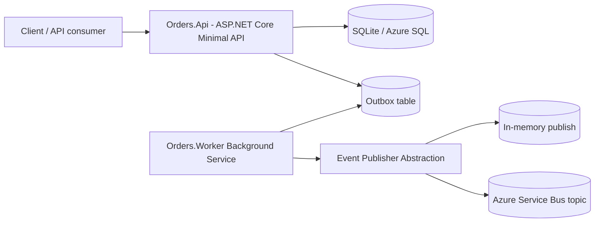

# Azure Orders Microservice (Portfolio / Lab)

This is an interview-defensible lab implementation of an Orders microservice with clean boundaries, outbox reliability pattern, async processing, and CI.

## Problem Statement

Order APIs often write business state and publish integration events separately, causing data/event drift on failures.  
This project demonstrates a **transactional outbox** to ensure order state and event messages stay consistent.

## Architecture



## Solution Layout

- `Orders.Api` - HTTP endpoints, health/readiness, request orchestration
- `Orders.Worker` - background dispatcher for pending outbox messages
- `Orders.Domain` - aggregate, value rules, status transitions
- `Orders.Infrastructure` - EF Core persistence, repository, outbox and publisher adapters
- `Orders.Tests` - unit tests + integration-style API test

## Domain Model

- Aggregate: `Order`
- Child entity: `OrderItem`
- Status lifecycle: `Created -> Paid -> Shipped`, with cancellation constraints

## Outbox Pattern

During order creation:
1. Persist `Order` to `Orders` table
2. Persist serialized `OrderCreatedEvent` to `OutboxMessages`
3. Commit once

Worker process:
1. Poll unprocessed outbox rows
2. Publish through `IEventPublisher`
3. Mark rows processed (or keep error details for retries/inspection)

## Local Run

### Prerequisites

- .NET SDK 8.0

### API

```bash
dotnet run --project Orders.Api
```

### Worker

```bash
dotnet run --project Orders.Worker
```

### Tests

```bash
dotnet test Orders.sln
```

## Configuration

No secrets are committed.

- `Orders.Api/appsettings.Development.json` includes local-only defaults
- Service Bus connection is optional:
  - Empty connection string => in-memory publisher (safe local mode)
  - Provided connection string => Azure Service Bus publisher

## Container

Build API container:

```bash
docker build -f Orders.Api/Dockerfile -t orders-api:local .
```

Run:

```bash
docker run -p 8080:8080 orders-api:local
```

## Azure Deployment Shape (Target Topology)

- `Orders.Api` -> Azure App Service (Linux container or code)
- `Orders.Worker` -> Azure Container Apps Job, Functions isolated worker, or dedicated worker App Service
- Database -> Azure SQL
- Messaging -> Azure Service Bus Topic
- Observability -> Application Insights / OpenTelemetry pipeline

## CI

GitHub Actions pipeline (`.github/workflows/ci.yml`) runs:
- restore
- build
- test

## Honest Limits (Portfolio Scope)

- Lab/portfolio implementation, not a production SLA-backed service
- Uses SQLite locally; production migration scripts and ops hardening are minimal
- No authn/authz, rate limiting, or advanced saga orchestration in this iteration
